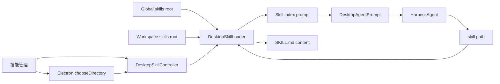
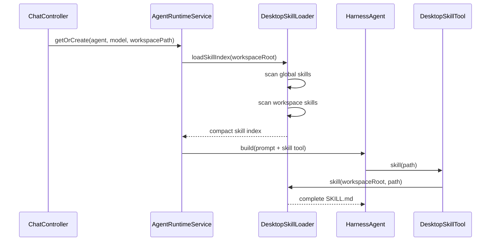
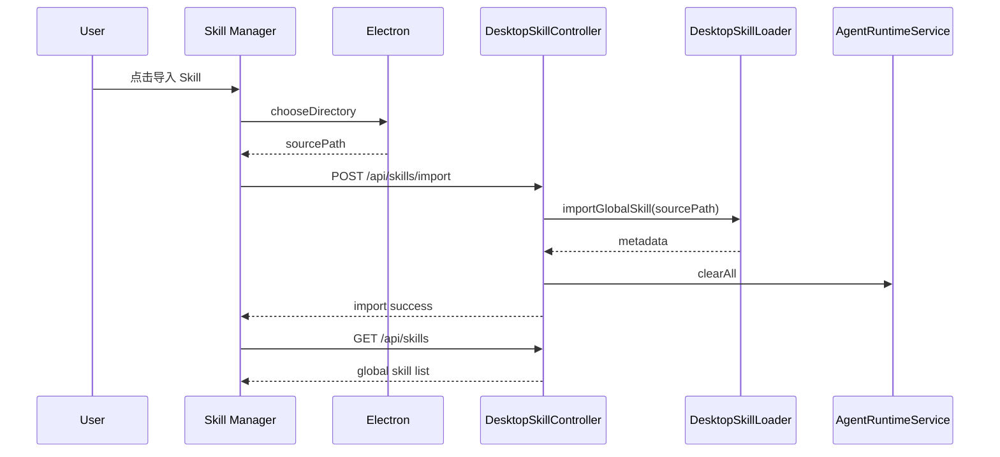

# AgentForge Desktop Skill 设计实现方案

## 1. 设计目标

AgentForge Desktop 的 Skill 能力优先实现一个简单、稳定、可落地的最小闭环，不在第一阶段引入复杂的 Skill 安装市场、数据库注册表或多级资源工具。

核心运行链路只包含两部分：

1. **Skill Prompt**：扫描 Skill 目录，将名称、描述和路径组成索引注入系统提示词。
2. **Skill Tool**：工具名为 `skill`，只接收一个 `path` 参数，按需读取对应 Skill 的完整 `SKILL.md`。

在此基础上，Desktop UI 增加一个轻量的“技能管理”页面，用于查看全局 Skill 和快捷导入本地 Skill 目录。

## 2. 功能边界

### 2.1 第一阶段实现

- 扫描全局 Skill 目录。
- 扫描当前工作空间 Skill 目录。
- 解析 `SKILL.md` frontmatter 中的 `name` 和 `description`。
- 向 Agent 系统提示词注入精简 Skill 索引。
- 提供单参数 `skill(path)` 工具。
- 左侧“新建任务”下方增加“技能管理”入口。
- 技能管理页默认展示全局 Skill 列表。
- 支持选择本地 Skill 文件夹并快捷导入全局目录。

### 2.2 第一阶段不实现

- Skill 市场和在线下载。
- Skill 版本升级和依赖解析。
- Skill 启用、停用和 Agent 级绑定。
- Skill 正文写入 SQLite。
- 独立的 Skill 资源读取工具。
- 在 Desktop 内直接编辑 `SKILL.md`。
- 删除、更新或覆盖工作空间中的 Skill。

## 3. Skill 路径规则

### 3.1 全局 Skill

默认路径：

```text
~/.agentforge-desktop/skills/
```

完整结构示例：

```text
~/.agentforge-desktop/skills/
├── document-review/
│   └── SKILL.md
└── spring-service-review/
    ├── SKILL.md
    └── references/
        └── checklist.md
```

全局 Skill 对所有工作空间可见，也是“技能管理”页面默认展示和导入的目标位置。

### 3.2 工作空间 Skill

默认路径：

```text
<workspace>/.agentforge/skills/
```

工作空间 Skill 仅对当前工作空间的 Agent 生效，适合保存项目规范、团队流程和仓库专用指南。

第一阶段由项目自身管理该目录，技能管理页不对其执行导入、删除或覆盖。

### 3.3 同名 Skill 优先级

当全局目录和工作空间目录中存在同名 Skill 时，使用工作空间版本：

```text
工作空间 Skill > 全局 Skill
```

注入 Prompt 时只保留最终生效项，避免模型看到两个同名能力。

## 4. Skill 目录规范

### 4.1 最小结构

```text
skill-name/
└── SKILL.md
```

### 4.2 `SKILL.md` 示例

```markdown
---
name: spring-service-review
description: 检查 Spring Boot 服务分层、事务和测试。当用户要求审查 Java 后端代码时使用。
---

# Spring Service Review

1. 阅读 Controller、Service、Mapper 和测试。
2. 检查事务边界和异常处理。
3. 运行最小相关测试。
```

### 4.3 Frontmatter

| 字段 | 规则 |
| --- | --- |
| `name` | 可选；缺失时使用 Skill 目录名 |
| `description` | 建议必填；用于 Agent 判断何时加载该 Skill |

第一阶段只解析这两个字段，不引入复杂 Skill Manifest。

## 5. 整体链路



## 6. Skill Prompt 设计

### 6.1 索引生成

`DesktopSkillLoader` 扫描两个 Skill root，只读取各 Skill 的 frontmatter，然后生成精简索引。

```text
<desktop-skills>
Available skills:
- name: spring-service-review
  description: 检查 Spring Boot 服务分层、事务和测试。
  scope: workspace
  path: /Users/example/project/.agentforge/skills/spring-service-review
- name: document-review
  description: 审查文档结构和内容表达。
  scope: global
  path: /Users/example/.agentforge-desktop/skills/document-review
</desktop-skills>
```

Prompt 中明确输出 `scope` 和 `path`，让模型能区分工作空间 Skill 与全局 Skill，并将索引路径原样传给 Skill Tool。

### 6.2 提示词规则

`DesktopAgentPrompt` 增加：

```text
# Skills
- desktop-skills 中是当前对话可用的 Skill 索引，包含全局 Skill 和当前工作空间 Skill。
- 当用户任务与某个 Skill 的 description 匹配时，先调用 skill，并将索引中的 path 原样传入。
- 读取完整 SKILL.md 后再按其说明执行，不要凭索引描述猜测完整流程。
- 不要一次读取与当前任务无关的所有 Skill。
```

### 6.3 Prompt 组装

```java
String skillIndex = skillLoader.loadSkillIndex(workspace.root());
String systemPrompt = DesktopAgentPrompt.render(null, skillIndex);
```

`DesktopAgentPrompt.render` 新增 `skillIndex` 参数，在基础 Desktop 规则和当前本机环境之后追加 `<desktop-skills>` 区块。

## 7. Skill Tool 设计

### 7.1 工具定义

Skill Tool 只提供一个参数：`path`。

```java
public final class DesktopSkillTool {

    private final DesktopSkillLoader skillLoader;
    private final Path workspaceRoot;

    @Tool("Read the complete SKILL.md for one Skill path from the injected Skill index")
    public String skill(
            @P("Skill directory or SKILL.md path from the injected Skill index") String path) {
        return skillLoader.skill(workspaceRoot, path);
    }
}
```

Tool 同时支持两种索引路径：

```text
/Users/example/.agentforge-desktop/skills/document-review
/Users/example/project/.agentforge/skills/spring-service-review
```

传入目录时自动追加 `/SKILL.md`；传入 `SKILL.md` 完整路径时直接读取。

### 7.2 路径校验

Tool 不能成为任意本地文件读取器。传入路径必须位于以下任一真实根目录内：

```text
~/.agentforge-desktop/skills
<workspace>/.agentforge/skills
```

校验步骤：

1. 拒绝空路径和 NUL 字符。
2. 将 Skill root 与目标文件转换为真实路径。
3. 校验目标路径必须 `startsWith` 全局根或当前工作空间根。
4. 拒绝通过符号链接指向根目录外的文件。
5. 最终文件名必须为 `SKILL.md`。
6. 限制单个 `SKILL.md` 大小，建议不超过 512 KiB。

### 7.3 为什么 Tool 使用 path

- Prompt 中已经包含 Skill 目录路径。
- 模型可以直接传递索引值，不需要额外的 ID 转换。
- 参考实现的渐进披露链路可直接复用。
- 通过严格根目录校验保证本地文件安全。

## 8. `DesktopSkillLoader` 实现

### 8.1 核心方法

```java
public final class DesktopSkillLoader {

    public String loadSkillIndex(Path workspaceRoot);

    public List<SkillMetadata> listGlobalSkills();

    public String skill(Path workspaceRoot, String requestedPath);

    public SkillMetadata importGlobalSkill(Path sourceDirectory);
}
```

`loadSkillIndex` 负责合并全局和工作空间 Skill；`listGlobalSkills` 仅服务于技能管理页；`skill` 供 Agent Tool 调用；`importGlobalSkill` 将用户选择的 Skill 目录导入全局根目录。

### 8.2 扫描规则

对每个 Skill root 只扫描：

- root 本身的 `SKILL.md`。
- root 的一级子目录中的 `SKILL.md`。

不递归扫描整个 HOME 或工作空间。

### 8.3 元数据

```java
public final class SkillMetadata {
    private String name;
    private String description;
    private String scope;       // GLOBAL / WORKSPACE
    private String path;        // Skill directory
    private String skillFile;   // SKILL.md
    private long lastModified;
}
```

## 9. HarnessAgent 接入

`AgentRuntimeService#build` 中加载 Skill 索引并注册附加工具：

```java
String skillIndex = skillLoader.loadSkillIndex(workspace.root());
String systemPrompt = DesktopAgentPrompt.render(null, skillIndex);
DesktopSkillTool skillTool = new DesktopSkillTool(skillLoader, workspace.root());

return HarnessAgent.builder()
        .runtime(runtime)
        .agentName(agent.name)
        .systemPrompt(systemPrompt)
        .additionalTool(skillTool)
        // 现有模型、记忆、权限与 Middleware 配置保持不变
        .build();
```

`HarnessAgent.Builder` 已提供 `additionalTool` 能力，不需要改造 Harness Agent 核心。

### 9.1 Agent 缓存

当前 Agent 按 Agent、模型和工作空间缓存。Skill 列表变更后，系统提示词中的索引也需要更新。

最小实现可以在以下时机调用 `AgentRuntimeService.clearAll()`：

- 导入全局 Skill 成功后。
- 用户在技能管理页主动刷新后。

第一阶段无需引入 Skill revision 和文件监听器。

## 10. 技能管理页面

### 10.1 入口位置

左侧栏顶部保持当前 Agent 图标和名称，在“新建任务”按钮下方新增“技能管理”入口：

```text
AgentForge Desktop
├── 新建任务
└── 技能管理
```

点击“技能管理”后，右侧主区域从对话工作台切换到 Skill 管理页。

### 10.2 页面内容

页面默认展示全局路径：

```text
~/.agentforge-desktop/skills
```

页面结构：

```text
技能管理
管理所有工作空间可用的全局 Skill

[点击选择或拖入 Skill 文件夹] [打开全局目录]
[搜索 Skill] [刷新]

全局 Skill (3)
├── document-review
│   审查文档结构和内容表达
│   ~/.agentforge-desktop/skills/document-review
├── spring-service-review
│   检查 Spring Boot 服务分层、事务和测试
└── ...
```

每个 Skill 条目展示：

- Skill 名称。
- description。
- 本地目录路径。
- `SKILL.md` 最后修改时间。
- “打开文件夹”操作。

第一阶段不在列表中提供删除按钮，避免用户误删包含脚本和资源的 Skill 目录。

### 10.3 快捷导入

页面提供与本地工作台一致的虚线导入区，支持两种方式：

- 点击“选择文件夹”，通过 Electron `chooseDirectory` 选择 Skill 目录。
- 点击“选择 ZIP”选择 Skill 压缩包。
- 直接将 Skill 文件夹或 ZIP 拖入导入区，拖入时显示高亮反馈。

ZIP 支持 `SKILL.md` 位于压缩包根目录，或位于唯一顶层 Skill 目录。后端解压时校验路径穿越、文件数量和总大小。

导入流程：

1. 前端获取选择或拖入的 Skill 目录路径。
2. 前端将该路径提交给本地后端。
3. 后端检查该目录下是否存在 `SKILL.md`。
4. 解析并校验 name 和 description。
5. 将整个目录复制到 `~/.agentforge-desktop/skills/<directory-name>`。
6. 刷新全局 Skill 列表。
7. 清理 Agent 缓存，使新 Skill 在后续对话中生效。

导入操作不修改、移动或删除源目录。

### 10.4 同名冲突

如全局 Skill 根目录中已存在同名目录，第一阶段不直接覆盖，提示：

```text
全局 Skill “spring-service-review”已存在，请先在全局目录中处理后重试。
```

这样可以避免导入过程覆盖用户已修改的 Skill。

## 11. 技能管理接口

### 11.1 全局 Skill 列表

```http
GET /api/skills
```

返回：

```json
[
  {
    "name": "document-review",
    "description": "审查文档结构和内容表达。",
    "scope": "global",
    "path": "/Users/example/.agentforge-desktop/skills/document-review",
    "skillFile": "/Users/example/.agentforge-desktop/skills/document-review/SKILL.md",
    "modifyTime": 1794969000000
  }
]
```

该接口只返回全局 Skill，对应技能管理页默认列表。

### 11.2 全局 Skill 目录

```http
GET /api/skills/root
```

该接口会确保全局 Skill 目录已创建，并返回目录路径，供页面的“打开全局目录”操作使用。

### 11.3 导入 Skill

```http
POST /api/skills/import
Content-Type: application/json

{
  "sourcePath": "/Users/example/Downloads/document-review"
}
```

返回导入后的通用 `SkillMetadata`。

### 11.4 刷新

列表接口每次读取真实文件系统，第一阶段无需独立 refresh 接口。前端点击刷新时重新调用 `GET /api/skills`。

## 12. 导入安全约束

导入目录可能包含脚本、符号链接和大文件，后端必须执行以下限制：

- 源路径必须是存在的本地目录。
- 源目录根必须存在 `SKILL.md`。
- 目录名不能是空、`.` 或 `..`。
- 拒绝将全局 Skill root 自身导入到它自身。
- 拒绝覆盖已存在的目标目录。
- 默认不跟随指向源目录外部的符号链接。
- 设置单个 Skill 的总文件数和总大小上限。
- 复制过程先写入临时目录，完成后再原子移动到目标位置。
- 任意文件复制失败时清理临时目录，不留下半完成 Skill。

## 13. 后端结构建议

```text
modules/skill/
├── controller/
│   └── DesktopSkillController.java
├── domain/
│   ├── api/SkillLoader.java
│   ├── api/SkillMetadata.java
│   └── SkillImportReq.java
├── service/
│   └── DesktopSkillLoader.java
└── tool/
    └── DesktopSkillTool.java
```

仅保留一个 Loader 服务完成扫描、索引、详情读取和导入，不在第一阶段拆分过多层次。

## 14. 核心时序

### 14.1 Agent 加载 Skill



### 14.2 导入全局 Skill



## 15. 测试设计

### 15.1 Loader 测试

- 全局 Skill 扫描。
- 工作空间 Skill 扫描。
- 同名工作空间 Skill 覆盖全局 Skill。
- frontmatter 中 name 和 description 解析。
- 缺失 name 时使用目录名。
- Skill root 不存在时返回空索引。
- 一个无效 Skill 不阻断其他 Skill 加载。

### 15.2 Tool 安全测试

- 读取全局 Skill 详情。
- 读取当前工作空间 Skill 详情。
- 拒绝其他工作空间的 Skill 路径。
- 拒绝 Skill root 外的任意文件。
- 拒绝 `..` 穿越和 symlink 逃逸。
- 路径为目录和完整 `SKILL.md` 时均可正常读取。

### 15.3 导入测试

- 正常 Skill 目录导入。
- 缺失 `SKILL.md` 时拒绝。
- 同名目标存在时拒绝覆盖。
- 导入不修改源目录。
- 中途失败时不留下半完成目录。
- 导入成功后清理 Agent 缓存。

### 15.4 前端测试

- “技能管理”位于“新建任务”下方。
- 默认列表只展示全局 Skill。
- 搜索可匹配 name 和 description。
- 导入成功后列表立即刷新。
- 导入失败显示后端错误信息。
- “打开全局目录”调用 Electron `openPath`。

## 16. 实施步骤

### 阶段一：Skill 运行链路

1. 在 `DesktopProperties` 中增加 `globalSkillRoot()`。
2. 新增通用 `SkillLoader`、`SkillMetadata` 和本地文件系统实现 `DesktopSkillLoader`。
3. 实现全局、工作空间扫描和同名覆盖。
4. 实现单参数 `DesktopSkillTool#skill(path)`。
5. 扩展 `DesktopAgentPrompt.render` 注入 Skill 索引。
6. 在 `AgentRuntimeService` 中注册 Skill Tool。
7. 补齐 Loader 与路径安全测试。

### 阶段二：技能管理页

1. 新增全局 Skill 列表和导入接口。
2. 在“新建任务”下方新增“技能管理”入口。
3. 实现 Skill 列表、搜索、刷新和打开目录。
4. 复用 Electron `chooseDirectory` 选择导入目录。
5. 实现导入进度、成功和冲突提示。
6. 导入成功后清理 Agent 缓存。

## 17. 验收标准

1. `~/.agentforge-desktop/skills` 中的 Skill 可出现在 Agent Prompt 索引中。
2. `<workspace>/.agentforge/skills` 中的 Skill 仅在当前工作空间出现。
3. 同名时工作空间 Skill 覆盖全局 Skill。
4. Agent 能将 Prompt 索引中的 path 传入 `skill`。
5. `skill` 只能读取全局根或当前工作空间根下的 `SKILL.md`。
6. 左侧“新建任务”下方可进入“技能管理”。
7. 技能管理默认展示全局 Skill 列表。
8. 用户可选择本地 Skill 目录导入到全局目录。
9. 导入不覆盖已存在的同名 Skill，也不修改源目录。
10. 导入成功后新 Skill 在后续对话中生效。
